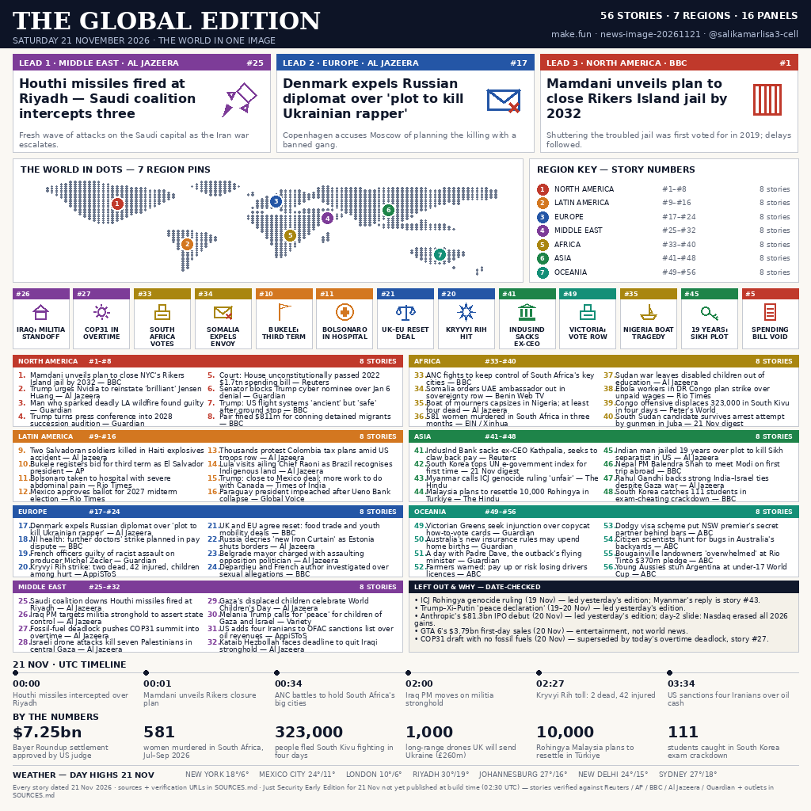

# The Global Edition — 21 November 2026

[](https://make.fun/bounty/news-image-20261121?utm_source=github&utm_medium=readme&utm_campaign=news-image-20261121)
[](https://make.fun/bounty/news-image-20261121/leaderboard?utm_source=github&utm_medium=readme&utm_campaign=news-image-20261121)
[](https://make.fun/bounty/news-image-20261121?utm_source=github&utm_medium=readme&utm_campaign=news-image-20261121)

**Saturday 21 November 2026 — the whole world in one image.**



## What it is

One 1024×1024 poster summing up 21 November 2026's world news:

- **56 numbered stories across 7 regions** (8 per region: North America,
  Latin America, Europe, Middle East, Africa, Asia, Oceania), each with
  its outlet cited on the poster.
- **3 lead stories:** Houthi missiles fired at Riyadh (Saudi coalition
  intercepts three); Denmark expels a Russian diplomat over an alleged
  plot to kill a Ukrainian rapper; Mamdani unveils a plan to close
  Rikers Island jail by 2032.
- **16 illustrated panels** (3 leads + 13 feature tiles) drawn from the
  day's stories.
- **Dot-matrix world map** with 7 numbered region pins + region key.
- **UTC timeline** (6 timed events), **by-the-numbers** strip (6 stats),
  **weather strip** (day highs/lows for 7 cities, Open-Meteo forecast)
  and a **"left out & why"** date-check box.

Every story was published or reported in the 21 November 2026 news
cycle; full verification URLs are in [SOURCES.md](SOURCES.md). The Just
Security Early Edition for 21 Nov was not yet published at build time
(02:30 UTC), so stories were verified against Reuters, AP, BBC,
Al Jazeera, The Guardian, ABC and the outlets listed in SOURCES.md.

## Regenerate

```sh
python3 main.py   # writes entry.png (1024x1024, deterministic)
```

Pure Python standard library + Pillow. Running the generator twice
produces a byte-identical `entry.png`.

## Entry

- **Competition:** `news-image-20261121` — "Sum up 21 November's world news in one image"
- **Author:** [@salikamarlisa3-cell](https://github.com/salikamarlisa3-cell)

## License

MIT — see [LICENSE](LICENSE).
